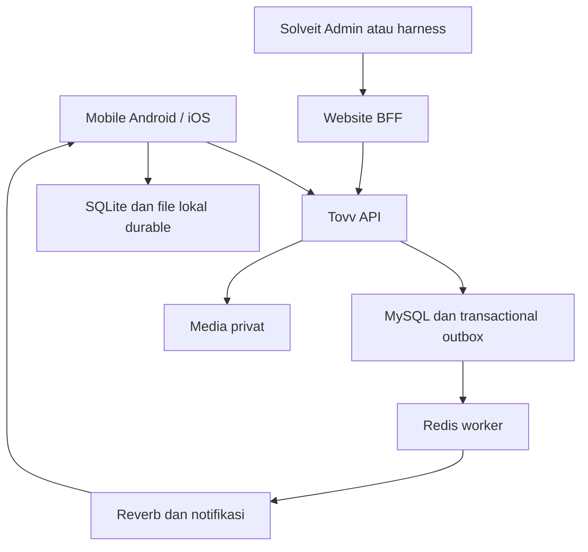

# ARCHITECTURE — Tovv

## Provenance, versi dan batas bukti

Paket **2.1 — 21 Oktober 2026**. Produk **Tovv**; pemilik, pengembang dan penerbit **Solveit Indonesia**. Status dokumen: spesifikasi/rencana; bukan bukti aplikasi sudah dibuat atau diuji.

Baseline yang benar-benar dibaca: PRD v2.0 (file sumber PRD(2).md, identik dengan salinan PRD (1).md), ARCHITECTURE, IMPLEMENTATION_PLAN, INTEGRATION_PLAN dan TEST_PLAN masing-masing berlabel v1.0 dengan acuan PRD v2.0. Tidak ditemukan versi lebih baru. VALIDATION_PLAN.md tidak ditemukan setelah pencarian nama; dokumen itu **disusun kembali**, bukan hasil pemeriksaan file lama. Pesan pengguna terbaru mengungguli baseline. Seluruh enam dokumen kini memakai versi paket 2.1.

Urutan baca: [PRD](PRD.md) → [ARCHITECTURE](ARCHITECTURE.md) → [INTEGRATION_PLAN](INTEGRATION_PLAN.md) → [IMPLEMENTATION_PLAN](IMPLEMENTATION_PLAN.md) → [TEST_PLAN](TEST_PLAN.md) → [VALIDATION_PLAN](VALIDATION_PLAN.md). PRD menguasai scope/aturan bisnis; kontrak dan model harus mematuhinya. Perubahan mengharuskan pembaruan requirement, task, test, fixture dan keputusan terkait pada paket yang sama.
## 1. Keputusan arsitektur

Modular monolith Laravel menjaga transaksi harga/reservasi/finance di satu database. Satu deployment dapat melayani banyak tenant; tidak membutuhkan server per modul. Batas modul tetap eksplisit dan website terpisah. Sasaran kapasitas adalah TEST_PLAN L-01–L-03, bukan skala nasional yang belum diukur.

| ADR | Keputusan dan konsekuensi |
|---|---|
| ADR-001 | Laravel modular monolith; domain services menguasai invariant; controller tipis |
| ADR-002 | RN/TS strict/Expo development builds; native proof Android dan iOS terpisah |
| ADR-003 | MySQL8.4 LTS; concurrency diuji MySQL, bukan SQLite pengganti |
| ADR-004 | Repo dan DB Tovv terpisah website; dapat berbagi host dengan resource/secret terisolasi |
| ADR-005 | Solveit Admin melalui BFF server, bukan browser service secret/shared DB |
| ADR-006 | SQLite durable outbox dan file directory persisten; semua aksi tidak otomatis offline |
| ADR-007 | DB transaction outbox + Redis queue; at-least-once delivery, consumer idempotent |
| ADR-008 | Adapter device/provider/simulated/manual_demo/disabled eksplisit; tanpa silent fallback |
| ADR-009 | Money signed BIGINT IDR internal, JSON string; bps integer; decimal arithmetic untuk persen |
| ADR-010 | Private Reverb channel epoch60detik; auth ulang dan current grant; bukan expiry token saja |
| ADR-011 | Media privat lewat endpoint auth setiap read; file sudah diunduh tidak dapat ditarik kembali |
| ADR-012 | Backend authority untuk harga/status/kapasitas/ledger, client hanya proposal |
| ADR-013 | Pembayaran manual_demo tanpa dependency provider, immutable receipts/allocations/reversals |
| ADR-014 | Original media immutable, overlay derivative berversi; capture origin dan location source dipisah |
| ADR-015 | Analytics query/read service satu sumber transaksi, cutoff dan formula berversi; tidak warehouse terpisah |
| ADR-016 | Jam bisnis demo terpisah security clock nyata; reset membedakan dataset_generation |

Tidak ada bank/gateway di jalur demo. Mobile, browser dan data GPS adalah input tak tepercaya; tenant/role/received_at/posted_at/status keuangan ditentukan server. Website backend tidak query DB Tovv langsung. Shared host memakai namespace DB/Redis/bucket/queue dan secrets berbeda.

## 2. Stack, struktur dan compatibility gate

Pertahankan Laravel13/PHP8.5 minimum8.5.7/MySQL8.4/Redis/Reverb dan Expo baseline. T-01 membaca lockfile aktual; jika belum ada pilih satu kombinasi Expo/RN/Node supported dari dokumentasi resmi, pakai `expo install` untuk paket SDK, jalankan compatibility check/build. Jangan menentukan versi kamera dari halaman latest tanpa kecocokan SDK. Hasil verifikasi dokumen bukan hasil build.

CameraView expo-camera → file cache; FileSystem durable copy; ImagePicker gallery; ImageManipulator untuk resize/compress, **bukan** renderer teks otomatis. Adapter OverlayRenderer memakai komposisi Image+Text yang dapat dicapture (kandidat react-native-view-shot/captureRef) setelah image loaded dan font ready; spike T-26 memverifikasi resolusi/rotasi/teks di kedua OS. Jangan snapshot live native camera view untuk original. Map thumbnail opsional terpisah dan sesuai lisensi; overlay koordinat teks selalu fallback. Tidak menambah AI/OCR/face SDK. Exact renderer version belum ditetapkan sebelum spike kompatibilitas.

| Path/modul | Tanggung jawab |
|---|---|
| mobile/app, src/features | Route tipis dan fitur identity, requests, pricing, fleet, trips, camera, finance, B2B, reports |
| mobile/src/core | Auth SecureStore, API, permission, SQLite outbox, durable media, synchronization, design tokens |
| backend/app/Domain | Identity, Fleet, Requests, Pricing, Operations, Media, Finance, BusinessAccounts, SaaSBilling, Reporting |
| backend/app/Infrastructure | Maps, private storage, push, overlay/PDF adapters, Admin assertion verifier |
| contracts | OpenAPI3.1, event JSON schemas, role DTO, contract fixtures |
| tools/admin-harness | Stub UI+BFF yang mengakses API nyata, berlabel ADMIN STUB |
| infra, docs/adr, docs/evidence | Runtime config, backup, decision records, actual evidence dan checkpoint |

Tidak ada HTTP antar modul dalam proses sama. Repository abstraction generik per tabel tidak wajib. Service kecil dengan invariant jelas lebih penting daripada lapisan yang tidak diperlukan.

## 3. Model data dan constraints

Semua tabel domain memiliki tenant_id NOT NULL, opaque ID, timestamps UTC, actor/version sesuai kebutuhan. users global dan lookup unit measure adalah pengecualian eksplisit. Composite foreign key (tenant_id,id) mencegah link antar tenant. Tenant tidak diterima hanya dari header/body tanpa membership.

| Domain | Entitas/relasi | Constraint utama |
|---|---|---|
| Identity | users→tenant_memberships; business_memberships→business_accounts; device_sessions | unique tenant/user; action scopes; org scopes |
| Delegation | delegations, delegation_audits | grantor/grantee tenant sama, scope subset, limit/expiry/version; no re-delegation |
| Fleet | vehicle_assets, driver_profiles, managed_partners, resource_locks | customer_vehicle bukan asset towing; resource row stabil untuk lock |
| Request | requests, request_parties, customer_vehicles, request_locations | satu customer_vehicle/request; parties sender/receiver/payer terpisah |
| Commercial | quote_versions, quote_items, cost_estimates, approvals, change_orders | unique request/version; sent immutable; accepted satu per request; source provenance |
| Execution | orders, service_units, trips, assignments, reservations, status_events, incidents, handovers | unique order/service_unit; order.active_assignment_id menjadi authoritative pointer; assignment history tidak dihapus |
| Media | media_packets, media_objects, media_links | unique tenant/client_media_id; packet original+overlay; parent_object_id; tenant/request/order/vehicle/stage links |
| Tracking | location_events, latest_positions | unique assignment/event_id; latest monotonic valid captured_at; source enum |
| Costs | actual_costs, cost_approvals, cash_advances, advance_settlements | expense source sekali; approved/reversed entries; finalization snapshot; refund kas tidak mengurangi P dua kali setelah credit |
| Invoice | invoices, invoice_items, invoice_sequences, credit_notes | unique tenant/number; snapshot issued; satu source commercial item tidak ditagih dua kali |
| Payment | payment_instruction_versions, payment_requests, payment_proofs, proof_reviews | no merchant credential table PROTO; unique tenant/reference; satu active request via invoice.active_request_id |
| Ledger | receipts, receipt_allocations, receipt_reversals, allocation_reversals, refund_records, cash_custody_events | unique verified proof/receipt; reversal punya source dan cap; amount>0; demo_mode wajib |
| B2B | accounts, members, rate_cards, terms_versions, favorite_routes | tenant+org policies, effective date; snapshots pada quote |
| SaaS | plan_versions, plan_snapshots, usage_events, usage_credits, saas_invoice_previews | unique tenant/service_unit/success; tidak memakai operator invoices |
| Reliability | idempotency_records, outbox_events, processed_events, audit_events | unique tenant/actor/operation/key; payload hash; no webhook inbox wajib |
| Reporting | export_jobs, report_snapshots, snapshot_row_ids | requested scope/hash/filter/as_of/formula_version; authorization saat create dan download |
| Platform | integration_clients, support_approvals, support_grants, consumed_nonces, access_audits | actor+tenant+expiry; approval sekali pakai; issuer/jti unique |

### Media packet fields

`client_media_id`, `capture_origin`, `event_at`, `device_captured_at`, `device_recorded_at`, `location_captured_at`, `server_received_at`, `timezone`, `latitude`, `longitude`, `accuracy_m`, `location_source`, `address_text`, `address_provider`, `address_fetched_at`, `note`, `uploader_id`, `is_demo`, `dataset_generation`. Null diperbolehkan untuk fakta yang tidak tersedia, bukan diisi koordinat default. Lokasi manual tidak memiliki accuracy GPS palsu. `media_objects`: kind original/overlay/thumbnail/customer_redacted, sha256, mime, byte_size, pixel_dimensions, storage_key, parent_id, renderer_version, ready_at. Original immutable; customer derivative dapat menghapus informasi tidak relevan, original tetap privat.

Packet states `pending_upload, processing, ready, failed, needs_review`; readiness bukan evidence completeness seluruh order. File hash server dicocokkan client, tetapi tidak menggantikan akses atau membuktikan kejadian. Foto identik pada order berbeda tidak didedup global dengan membocorkan keberadaan file; idempotensi memakai client_media_id+tenant.

## 4. Izin tindakan dan isolasi

| Aksi | Izin minimum | Guard tambahan |
|---|---|---|
| Request create/read | requests.write/own.read atau dispatcher | tenant+own request atau business membership |
| Quote send/override | quotes.manage / quotes.override | delegasi limit dan expiry; cost complete; hard safety tidak bisa override |
| Reserve/reassign | assignments.manage | unit+driver locks; expected version; operator assets only |
| Status/location/media | assignments.execute atau request.evidence.write | assignment aktif; customer request sendiri; historical upload khusus review |
| Invoice issue | invoices.issue | approved commercial sources; unique numbering |
| Proof submit | payments.submit | own invoice atau assisted permission; tidak receipt |
| Proof verify/reverse/refund | payments.verify / payments.correct | finance/owner eksplisit; second actor untuk own submitted proof; reason dan dependency locks |
| Instruction change | payment_instructions.manage | owner; versioned, nonpayable only; request existing tetap snapshot |
| Export costs/margin | reports.financial | owner/finance tenant; B2B hanya service/customer fields |
| Support detail | support scope + owner approval | tenant/order/resource scope dan expiry; platform summary tak cukup |

Policy dipasang di query/list/search/export/cache/job/realtime/file, bukan UI saja. Cache key environment:tenant:actor_scope:resource:version. Worker harus resolve tenant dari trusted job context dan validasi link, tidak payload bebas. 404 untuk objek tenant lain, 403 untuk operasi yang diketahui tetapi tidak berizin. Foto/koordinat tidak masuk platform summary. Revoke menghentikan akses baru; salinan yang sudah diunduh tidak dapat ditarik.

## 5. Transaksi dan state machine

Enum bisnis normatif PRD §5; jangan membuat status tunggal paid untuk semua objek. Controller menerima command dan expected_version, service memeriksa allowed transition.

### 5.1 Accept quote dan reservasi

1. Mulai transaksi; validasi tenant, requester/approver, quote version, sent, expiry.
2. Lock resource rows stabil untuk seluruh unit dan driver yang terlibat, urut type+ID untuk mengurangi deadlock.
3. Semua jalur create/reassign/cancel reservasi wajib mengikuti lock yang sama.
4. Query overlap confirmed: existing.start < requested.end AND existing.end > requested.start. Pertimbangkan buffer yang sudah termasuk interval.
5. Jika overlap, rollback dan 409 CAPACITY_CONFLICT; jangan accepted sebagian.
6. Buat order/service unit/trip/reservations, snapshot quote/plan, audit dan outbox dalam satu commit.
7. Dispatcher dapat offer assignment; driver acceptance memfinalisasi assignment, bukan menciptakan order kedua.

Jangan mengandalkan UI availability check atau Redis lock saja. Retry deadlock dibatasi dan tetap memakai idempotency key. Reassignment melibatkan lock old/new resource dan expected version.

### 5.2 State transitions

| Command | Dari → ke | Guard dan efek |
|---|---|---|
| SendQuote | draft → sent | Data minimum, expiry, biaya/ketidakpastian terlihat; supersede sent lama atomik |
| AcceptQuote | sent → accepted | Actor/B2B approval + capacity atomik; create order snapshot |
| AcceptAssignment | offered → accepted | Driver/unit valid, expected version; order assigned |
| StartPickup | assigned → en_route_pickup | Assignment accepted; readiness minimum atau exception owner tercatat |
| ArrivePickup | en_route_pickup → arrived_pickup | Driver aktif; GPS boleh unavailable dengan alasan |
| StartLoading | arrived_pickup → loading | Evidence pickup minimum dua foto atau exception beralasan |
| StartTransit | loading → in_transit | Muatan dikonfirmasi petugas; bukan keputusan otomatis GPS |
| ArriveDelivery | in_transit → arrived_delivery | Driver aktif; input saat kendaraan berhenti |
| Handover | arrived_delivery → handed_over | Foto delivery, penerima, acceptance/objection; disputed tidak billable otomatis |
| CloseOrder | handed_over → closed | Evidence minimum, biaya final/provisional ditandai; outstanding boleh ada |
| Cancel | confirmed/assigned/en_route_pickup/arrived_pickup → canceled | Belum loading; alasan, biaya pembatalan hanya jika disetujui; release reservations |
| Abort | loading/in_transit/arrived_delivery → aborted | Catat lokasi, custody/PIC dan rencana penyelesaian; release hanya kapasitas yang benar-benar bebas |

Event offline yang datang sesudah reassignment bukan instruksi untuk memundurkan status. Expected version tidak cocok →409, event lokal berubah needs_review dengan reason conflict/rejected. Resolved incident tidak otomatis mengubah execution.

### 5.3 Verifikasi pembayaran, reversal dan concurrency

1. Verifikasi permission terkini dan `Idempotency-Key`; key unique tenant+actor+operation+key dan payload hash. Key sama/hash berbeda409; response loss replay hasil sama. Unique business constraints tetap berlaku setelah retention key30hari.
2. Dalam satu transaksi, lock invoice (urutan ID stabil bila lebih dari satu), payment request/proof, receipt/correction entries terkait. Semua jalur verify/reverse/credit/refund menggunakan urutan ini. Periksa scope, invoice version, status proof pending_review/flagged_review, actor berbeda dari submitter, nominal positif, reference risk, currency IDR, demo_mode.
3. Reused reference tidak otomatis melunasi. Normalized reference key disimpan per tenant+method+claimed date untuk deteksi; duplicate exact document ID memakai unique index bila operator menetapkannya sebagai unik. Flag bukan bukti fraud; reviewer harus memberi alasan resolution. Proof yang sama tetap hanya satu receipt source melalui unique proof_id.
4. Receipt amount = jumlah yang diverifikasi DEMO. Allocation = min(amount tersedia, outstanding terbaru) untuk invoice yang sah; jika desired allocation client sudah stale, kembalikan409 untuk review atau tawarkan jumlah terbaru tanpa commit otomatis. Sisa menjadi unapplied. Simultan dua proof untuk invoice yang sama tidak menghasilkan outstanding negatif.
5. Simpan receipt, allocation, audit, proof verified, update request fulfilled bila jumlah request teralokasi, dan outbox satu commit. Saldo derived atau cached transactional balance harus cocok ledger. Receipt tidak dibuat dari tombol customer atau screenshot.
6. Kredit setelah invoice settled memerlukan allocation reversal sebesar excess terlebih dahulu dalam transaksi sama. Refund recorded mengambil available receipt; jika perlu, reverse allocation sesuai keputusan. Refund tidak otomatis credit invoice; niat koreksi kewajiban harus explicit.
7. Membatalkan verification membuat receipt reversal dan seluruh allocation reversal terkait, proof verification_reversed; alasan/actor/time wajib. Jika receipt telah punya refund, tolak409 DEPENDENT_FINANCIAL_ENTRY sampai koreksi dependensi disetujui. Receipt reversal tidak ditambah refund atas dana sama.
8. Publish event hanya setelah commit. Retry/deadlock terbatas dengan key tetap. DB failure rollback semua, tidak membiarkan receipt posted tanpa allocation/audit.

Invoice sequence lock per tenant/tahun, bukan MAX()+1. Corrected invoice mempertahankan sejarah; replacement mengacu asal; kredit sah menghapus kewajiban asal, bukan delete. Menolak proof tidak membuat reversal karena belum ada receipt. Expired request memindahkan bukti ke flagged_review, bukan menolak fakta penerimaan secara otomatis. Invoice void/corrected memerlukan review manual untuk menentukan tujuan alokasi.

### 5.4 Delegasi dan usage

Delegation version dibaca di bawah lock sebelum commit tindakan sensitif; revocation yang commit lebih dahulu membuat tindakan berikutnya ditolak. Owner-driver memakai ability context sempit pada endpoint execute; mode UI tidak memberikan semua scope. Daftar tindakan harian query/materialized projection yang bisa dibangun ulang, bukan authoritative workflow state.

Handover dan usage eligibility/outbox satu transaksi. Dispute atau incomplete evidence tidak billable; approval kemudian membuat success event unik satu service unit. Plan snapshot tidak berubah karena package saat ini berubah. Usage credit tidak mengubah invoice jasa dan refund jasa tidak otomatis mengredit SaaS.

### 5.5 Transisi dokumen pembayaran dan waktu kedaluwarsa

| Objek/command | Transisi | Guard/efek |
|---|---|---|
| Invoice issue | draft → issued | nomor unik, commercial approved, snapshot immutable |
| Invoice void | draft/issued → void | hanya belum ada receipt/alokasi; reason; jika sudah ada transaksi gunakan credit/correct, bukan void langsung |
| Invoice correct | issued → corrected | linked credit/replacement dan reversal excess allocation; history utuh, tidak menghitung dua invoice penuh |
| Create payment request | baru → active | invoice issued/version sah, amount>0<=outstanding, snapshot instruction; request active lama superseded atomik |
| Expire request | active → expired | business clock melewati expires_at; tidak membuat proof rejected/receipt reversal |
| Correct/cancel request | active/expired → superseded atau canceled | reason/version, invoice berubah; bukti lama masih bisa review |
| Fulfill request | active/expired → fulfilled | verified allocations sah memenuhi requested amount; late memerlukan review dahulu |
| Proof submit | baru → pending_review atau flagged_review | late/stale/reference reuse flagged; no balance effect |
| Proof reject | pending_review/flagged_review → rejected | reviewer berizin, reason; resubmission membuat proof baru linked ke asal |
| Proof verify | pending_review/flagged_review → verified | finance review/lock/version, flagged resolution; receipt posted sekali |
| Verification reverse | verified → verification_reversed | correction beralasan, reverse allocations+receipt; dependency guard |
| Receipt reverse | posted → reversed | satu reversal penuh; refund parsial tidak mengubah receipt menjadi reversed |
| Refund | requested → approved → recorded; requested → rejected; requested/approved → canceled | recorded adalah bukti demo+pencatatan ledger, bukan dana ditransfer |

Proof verification_reversed terminal; pengajuan/periksa ulang memakai proof baru dengan prior_proof_id dan duplicate-reference review. Request fulfilled yang receipt-nya direversal berubah superseded dan finance dapat membuat request baru, bukan menghapus histori fulfillment. Koreksi invoice membatalkan active_request pointer dan menandai request terkait superseded. Sebuah request expired dapat menerima bukti terlambat; status tidak membuktikan ada/tidaknya uang.

Idempotency record di-claim memakai unique constraint sebelum command; concurrent in-flight request yang belum selesai mengembalikan409 IDEMPOTENCY_IN_PROGRESS dengan retryable=true dan Retry-After, bukan key baru. Setelah commit replay hasil awal. Semua mutasi receipt/quote/reservation/media-complete/usage menyimpan resource business uniqueness juga. Demo clock berlaku hanya scheduled business transition, tidak mengubah nonce/token/retensi keamanan.

## 6. Offline dan media pipeline

Outbox lokal: local_id, tenant_id, actor_id, dataset_generation, aggregate_id, assignment_version, command_type, payload_version, payload, event_at, idempotency_key, dependency_id, attempts, next_attempt_at, status, last_error. Status PRD §5. Persist original ke directory app durable, fsync/atomic rename bila API mendukung, baru commit row SQLite dan tampil saved; kegagalan di antara tahap meninggalkan orphan yang direkonsiliasi startup, bukan menghapus packet pending.

Original disalin sebelum overlay/compress. Original limit prototype20MiB, derivative target long-edge1600px JPEG quality~0,8 maksimum5MiB (target diuji; foto PNG/HEIC harus dinormalisasi dengan tetap menjaga original yang didukung). Jika original tak didukung server, tampil error format dan pilih capture ulang; jangan kehilangan file. Limit client/server identik dalam contract config. Original/overlay upload ke staging per packet, server menghitung checksum; complete packet hanya setelah semua object wajib ready. Upload ulang UUID sama mengembalikan object sama; bytes berbeda pada UUID sama409. Multipart resumable tidak wajib, retry per object cukup untuk batas prototype.

Draft request offline memiliki local UUID; sinkronkan request lebih dahulu, mapping ID tersimpan, lalu media_links. Kamera/gallery, input condition dan overlay dapat dilakukan offline; reverse geocode/map tidak memblokir. Kamera denied fallback gallery/note berlabel; storage penuh tidak auto-delete pending. Logout mengunci akses cache per akun dan memberi pilihan kirim/arsip lokal aman; no silent discard. Credential SecureStore, SQLite tidak diasumsikan terenkripsi default; jangan menyimpan secrets di payload. Pending file minimal, OS protected app storage; encryption-at-rest tambahan dievaluasi jika pilot memakai data nyata.

Drain serial per aggregate, concurrency antaraggregate dibatasi. Restart sending→pending. Network/5xx exponential backoff+jitter;401 reauth;403 stop;409 needs_review;422 edit/retry baru dengan event baru jika payload berubah. Status/expense/handover offline pending, bukan final server. Accept quote/reserve/verify receipt/reverse/change instructions hanya online. Assignment revoked: old status ditolak; evidence historic boleh endpoint review sesuai policy, tidak dimasukkan ke tugas driver baru otomatis.

## 7. Tracking dan realtime

Native Expo Location/TaskManager, bukan JS timer untuk background. Task start saat assignment relevan dimulai; stop handover/cancel/abort/reassign/logout. Customer capture lokasi request adalah izin foreground satu kali, bukan pelacakan customer. last_known device diberi stale/source, manual pin tidak dianggap device. Driver active ingest dibatasi assignment/version; replay endpoint terpisah demo-only.

Latest diperbarui hanya event valid captured_at lebih baru (tie-break ID server), future>120detik quarantine; batch bisa memuat late events untuk history tanpa menggeser latest. Status derived stale>90detik dari clockserver nyata untuk device; replay memakai demo clock dan badge. Tracking menggunakan capture/device/server timestamps, bukan uploaded_at sebagai umur lokasi.

Private channel epoch=floor(server_unix_time/60); publisher hanya epoch aktif, subscriber reauth ketika epoch berganti. Tiket exp<=60detik, grant/current membership dicek saat auth; pencabutan target<=60detik harus diuji. REST snapshot version+server_time saat reconnect; dedupe event_id, discard event versi lebih tua. Owner/finance dan customer DTO/channel terpisah; hindari mengirim margin ke channel umum order. Polling30detik layar aktif fallback yang terlihat, bukan klaim live ketika stale.

## 8. Analytics, ekspor dan waktu

Implementasikan ReportingReadService yang menjalankan definisi M-01–M-12 PRD, dipakai dashboard dan export. Query dalam snapshot DB konsisten, `as_of` tercatat; filter event/posted date jangan disamakan. Jangan join invoice→receipt→cost tanpa pre-aggregation yang menyebabkan fan-out. Scope organisasi sebelum agregasi; row IDs dapat drill-down bila diizinkan. Data kosong yang diketahui boleh0; cost missing null dan coverage terpisah.

Export async menyimpan actor/scope/filter/formula_version/as_of/dataset_generation, row IDs dan rendered artifact. Revalidasi policy ketika worker berjalan dan saat download, expiry max24jam demo. CSV formula escaping; PDF template fixed, escaped user strings, no arbitrary network URLs/fonts from input. Semua DEMO. File temporary dan export mengikuti retensi media serta grant revocation; download tidak membeberkan original EXIF yang tidak diperlukan. Snapshot report hanya untuk reproducibility, bukan dashboard angka hardcoded.

Waktu domain occurred_at, device_recorded_at, server_received_at, financial posted_at eksplisit. DemoClock tidak mengubah TLS/auth/token TTL/nonce/retention security. Retensi data nyata menggunakan clock server, bukan demo time-travel. Demo reset generation mencegah upload sesi lama menimpa seed baru.

## 9. Deployment, observability, backup/restore

Compose dev: API/PHP-FPM, MySQL8.4, Redis, worker, scheduler, Reverb dan S3-compatible private storage. Demo dapat satu VPS dengan resource limits dan backup di lokasi terpisah; bukan shared hosting PHP tanpa worker. Tidak ada sizing produksi sebelum benchmark. Mobile remote membutuhkan HTTPS hostname reachable, bukan localhost laptop. No payment webhook tunnel diperlukan.

Log structured request_id/tenant/actor pseudonym/command/duration/outcome; tanpa token/foto/koordinat mentah. Monitor queue age, outbox lag, media pending age/error, proof review age, stale fraction, API latency, export failures, provider modes dan budget. Audit immutable secara aplikasi untuk harga/approval/delegasi/assignment/invoice/receipt/refund/grant; tidak mengklaim tamper-proof storage.

Retensi PROTO: raw GPS7hari, media14hari sesudah sesi, audit teknis30hari. Export max24jam; unsynced local media diperingatkan sebelum purge, tidak dihapus karena sukses palsu. Seed sintetis boleh dibangun ulang; evidence QA dianonimkan. Backup terenkripsi dengan akses tim terbatas, retention30hari default demo; manifest memuat DB snapshot time, object keys/hashes, schema/seed version. Cleanup tidak menghapus media yang masih direferensikan snapshot dalam retention backup tanpa manifest yang konsisten.

Backup sebelum migrasi/reset dan harian selama sesi aktif. Restore drill ke DB+bucket baru: stop worker, restore schema/data+media, validasi FK/count/receipt balance/hash, jangan mengirim notifikasi lama (disable outbound), rotate/revoke token sesuai runbook, start worker dan read test. RPO/RTO komersial belum dijanjikan; durasi dan data gap diukur. Restore seed ulang saja bukan bukti restore backup.

CI minimum lint/typecheck/unit, MySQL feature/concurrency, contract, secrets/dependencies, Android build dan iOS build bila signing tersedia. Snapshot compatible additive migrations; rollback app jangan destructive rollback database. Checkpoint mencatat SHA, exactversions, blockers dan evidence; semua saat dokumen ini diserahkan belum diimplementasikan.

## 10. Referensi dan pertumbuhan bersyarat

Referensi resmi dan status verifikasi pada PRD §10 serta INTEGRATION_PLAN. Tidak ada dependensi baru yang sudah dinyatakan kompatibel melalui build. Tambah worker jika queue lag terukur, indeks/query tuning sebelum read replica, pisah Reverb jika koneksi/bandwidth terukur, dan evaluasi native location khusus hanya bila device proof membuktikan gap. Multi-service, Kubernetes dan data warehouse bukan syarat prototype.
